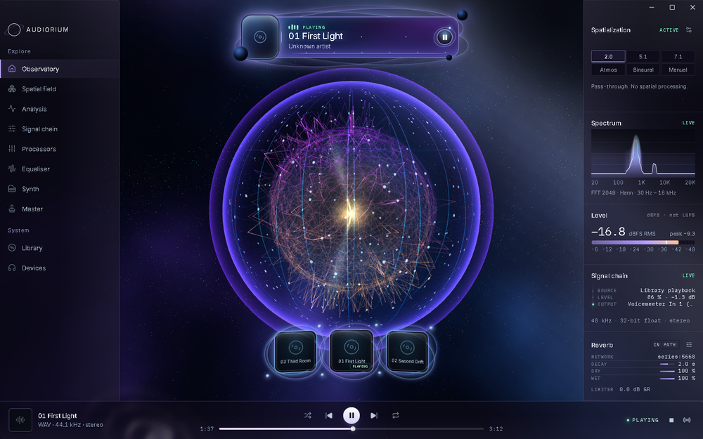
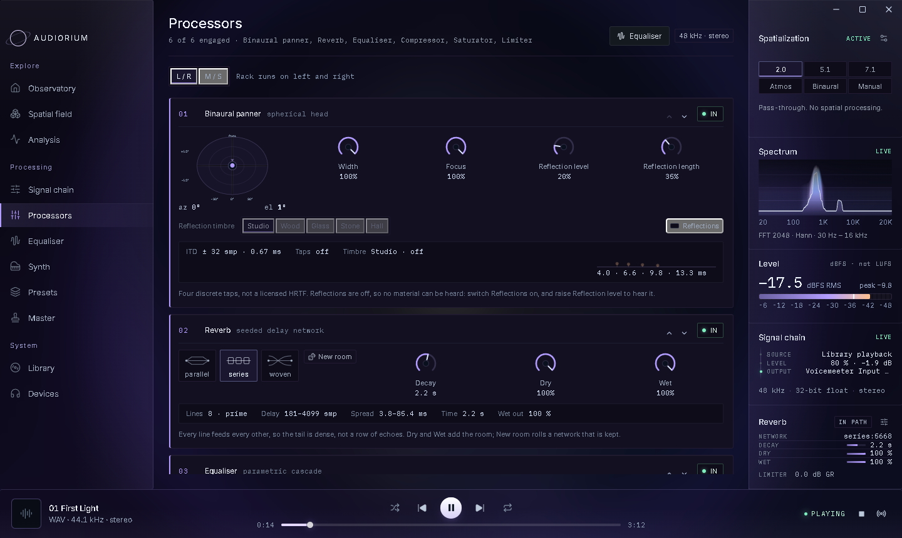
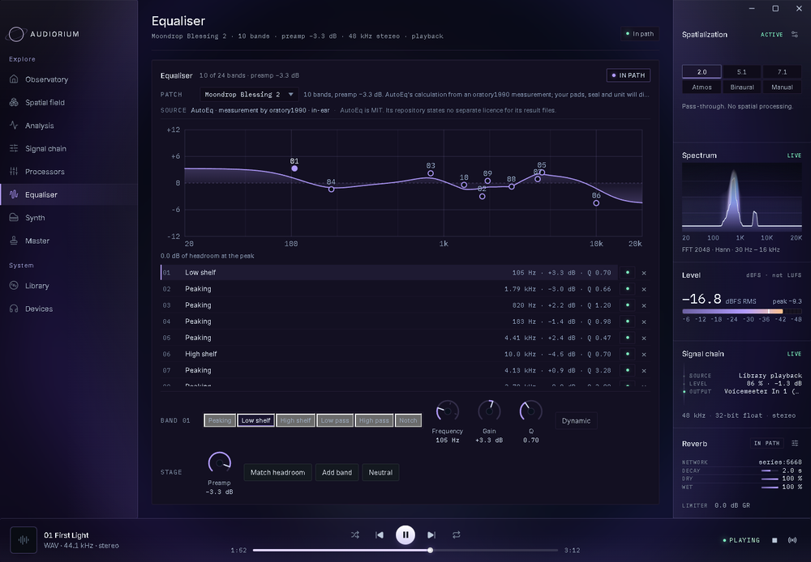
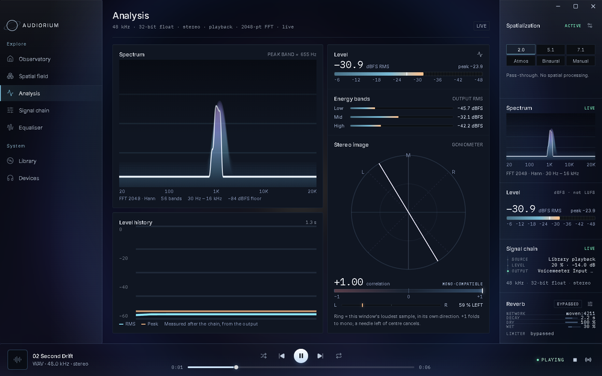

# Audiorium

A music player for Windows that shows you what it is doing to the sound.

Audiorium decodes the files on your disk and plays them through five stages of
DSP you can inspect and adjust: a spatial renderer, a binaural panner, a reverb,
a 24-band parametric equaliser and a look-ahead limiter. Its meters and its
spectrum are computed from real audio — the frames it hands to the sound card,
or a source you point it at — so a change to the chain shows up in what you see
as well as in what you hear.

It runs on one machine and reads one folder. There is no account, no telemetry
and no network code anywhere in the app. The only files it writes are its own
settings and a log.



## Playing your files

The Library page walks a folder you choose, reads tags from the files, lists what
it finds and plays the one you pick. MP3, FLAC, WAV, ALAC, AAC/M4A and Ogg Vorbis are decoded in Rust
with Symphonia; AIFF and Opus are refused with the decoder's own message rather
than guessed at. Each track is decoded on its own thread, resampled to the app's
single 48 kHz stereo float stream and written to a WASAPI output in shared mode,
with the chain processing every frame on the way.

The transport does what it says: play, pause, resume, stop, seek, previous and
next, with the position taken from the audio that actually reached the device,
plus a shuffle and a repeat mode (off, all, one) that only act when a track ends
or you press next. Closing the window asks whether to quit or to keep playing
from the tray, and the tray icon brings it back.
Playback can be moved to another output while a track is running; the stream is
reopened at the position already heard. The chosen output is remembered, and if
it is missing at launch the Windows default is used until it returns.

## The chain

Every frame passes these five stages in this order. Any of them can be taken out
of the path, and a bypassed stage is bit-exact: the samples come back out
unchanged.

1. **Spatial renderer.** Six modes. Stereo passes through untouched; 5.1 and 7.1
   place a stereo mix on virtual speakers; binaural applies head shadowing,
   interaural delay and crossfeed; Manual places two speakers by hand with an
   optional height pair; Atmos derives a 7.1.4 bed and hands it to Windows
   Spatial Sound, which renders it with whatever format is selected in Windows
   sound settings.
2. **Binaural panner.** A spherical-head model with azimuth, elevation, width,
   focus and four timed early reflections in five material colours. It is not a
   measured HRTF and it has no tail of its own.
3. **Reverb.** Eight prime-length delay lines that feed each other, joined in one
   of three routings, with separate dry and wet levels and a decay that reads as
   reverb time from a fifth of a second to sixteen. New room rolls a network and
   keeps it, so the same room comes back after a restart.
4. **Parametric equaliser.** Up to 24 RBJ biquads — peaking, low shelf, high
   shelf, low pass, high pass and notch — behind a preamp, with the response
   curve drawn from the coefficients the audio path is actually running. A band
   change is crossfaded over 10 ms so it does not click, and the page reports the
   headroom the curve leaves.
5. **Limiter.** A look-ahead peak limiter: 72 samples of look-ahead, a −0.3 dBFS
   ceiling, fast/medium/slow release, mid/left/right detection, optional soft
   clip and automatic make-up that normalises the limited peak to the ceiling.
   It is not a true-peak limiter and not a loudness normaliser.



## Equaliser patches

The equaliser workspace ships three kinds of patch and keeps them apart, because
they rest on different evidence.

- **Shapes** are ten starting points written for this app: Flat, Bass shelf,
  Treble trim, Presence, Rumble filter, Vocal, Warm tilt, Bright tilt,
  Butterworth 30 Hz and Quiet level. Each is nine peaking bands on the octave
  centres at one-octave Q, so a shape can be bent band by band.
- **Corrections** are fourteen headphone profiles computed by
  [AutoEq](https://github.com/jaakkopasanen/AutoEq) from oratory1990's
  measurements, vendored unmodified with their model, source directory and fetch
  date recorded in `src-tauri/assets/corrections/SOURCES.md`.
- **Fits** are the two Moondrop LAN 2 tunings, which AutoEq has no profile for.
  They were fitted here from a published squig.link measurement against the
  Harman in-ear target, and the app says so where the picker names them.

Editing a shipped patch does not overwrite it: the engine saves a copy, makes
that copy active and follows it from then on. All of it survives a restart.



## Measurement

The Analysis page draws a 2048-sample Hann FFT folded into 56 logarithmic bands
from 30 Hz to 16 kHz, the RMS and sample peak in dBFS, low/mid/high energy, a
goniometer with the window's correlation, and a rolling level trace. The
spectrum is drawn as a surface: every frame from the last half second sits behind
the live curve, so you can see where the music has just been. Pausing freezes the
readings where they are; stopping fades them out.

Everything is labelled for what it is. Levels are dBFS, not LUFS, and the app
says so where it shows them. An idle engine reports a dash instead of inventing a
number, and the observatory settles back to a plain sphere.



## Listening to something else

The Devices page can capture a single source — any input endpoint, or the
loopback of any output, which is how an application playing on its own device
still reaches these meters — and send it to the monitors through the same chain,
on an output you choose. Capturing the device you are monitoring into is refused
with the reason shown. Nothing is recorded to disk and nothing from the Windows
mix is captured wholesale.

The optional virtual audio device that can give Audiorium its own endpoints —
so any application could pick **Speakers (Audiorium)** as its output — is a
kernel driver and is not part of this repository. The app works without it, and
the Devices page still reports whether a build of the device is installed and
running on the machine.

## Building it

No binaries are published here; the app is built from this source. You need, on
Windows 10 or 11:

- Node.js 24 and npm
- a stable Rust toolchain with the MSVC target
- Visual Studio 2022 C++ build tools and the Windows SDK
- the WebView2 runtime, which ships with Windows 10 and 11

```sh
npm ci
npm run tauri dev
```

`npm run dev` alone serves the frontend on `127.0.0.1:1420` in a browser, which
is useful for layout work; the native features report themselves as unavailable
there. `npm run build` type-checks strictly and produces the frontend bundle.
`npm run tauri build` produces `src-tauri/target/release/audiorium.exe` and an
NSIS installer under `src-tauri/target/release/bundle/nsis/` that installs for
the current user and needs no administrator.

## Tests

```sh
npm test                                        # frontend, Vitest
cargo test --manifest-path src-tauri/Cargo.toml # Rust, including all the DSP
```

The Rust suite covers the parts where being wrong is not visible on screen: the
limiter holding its ceiling, the panner's symmetry, the reverb's seeded
reproducibility, the equaliser's measured response, and bit-exact bypass for
every stage. The frontend suite covers the scene's geometry, the readings it
derives from the engine, and the workspace components.

## Where your data goes

| Path | What is there |
| --- | --- |
| `%APPDATA%\AUDIORIUM\state.json` | the chain settings and every saved patch |
| `%APPDATA%\AUDIORIUM\window.json` | where the window was left |
| `%APPDATA%\AUDIORIUM\audiorium.log` | the launch line and any panic, capped at 256 KB |

The library folder, the chosen devices, the playback level, the spatial settings,
the theme and the reduced-motion preference live in the WebView's own local
storage. Deleting
`%APPDATA%\AUDIORIUM` clears the chain and every saved patch. `AUDIORIUM_CONFIG_DIR`
and `AUDIORIUM_LOG_PATH` move the folder and the log, which is how the tests keep
their own.

## Layout

```
src/                          React frontend: workspaces, instruments, scene
src-tauri/src/                Rust: decoder, chain, five DSP stages, analysis,
                              capture, devices, library, settings
src-tauri/assets/corrections/ published headphone profiles and their sources
tools/                        the scripts that fitted the two LAN 2 profiles
docs/                         audio architecture, dependency and license record,
                              feature status, implementation audit
```

## What it does not do

- It is Windows-only. The audio path, the device dialogs and the spatial output
  are Windows APIs, and no other platform has been attempted.
- Output is one shared-mode stream at 48 kHz, so nothing is bit-perfect, nothing
  uses exclusive mode, and high-resolution files are resampled.
- The queue is the scanned folder order held in memory: no playlists, no gapless
  playback, no resume point and no play counts.
- There is no loudness measurement (LUFS), no true peak, no spectrogram, no
  offline file analysis, no convolution and no VST hosting.
- The Atmos mode needs spatial sound enabled for the selected output in Windows.
  A stereo file carries no objects, so the bed is derived, and no Atmos bitstream
  is decoded anywhere.
- The installer is unsigned. Until a certificate is configured, public downloads
  warn about an unknown publisher, and SmartScreen reputation builds separately
  from the signature.
- Window dragging, keyboard navigation, long runs and slow machines have not been
  tested as thoroughly as the DSP has. `docs/FEATURE_STATUS.md` records the state
  of each feature and what was actually observed.

## Third-party material

The code is MIT. Bundled material is not all covered by that, and the difference
matters:

- The fourteen AutoEq profiles were fetched from AutoEq's `results/oratory1990`
  directory. AutoEq's code is MIT, but no separate license is stated for those
  result files, and the measurements behind them belong to third parties. **Their
  terms for redistribution are unconfirmed**, which `src-tauri/assets/corrections/SOURCES.md`
  and `docs/DEPENDENCIES_AND_LICENSES.md` both record. Treat this as a question
  to settle before any commercial use.
- Inter and IBM Plex Mono are self-hosted under the SIL Open Font License 1.1,
  with both license files beside the fonts in `src/assets/fonts/`.
- Every Rust and JavaScript dependency, its version, license and role in the app
  is listed in `docs/DEPENDENCIES_AND_LICENSES.md`.

## License

[MIT](LICENSE). Do what you like with the code, keep the notice.

## Contributing

Issues and pull requests are welcome. Two things make a patch easy to take: the
tests above still pass, and the app still tells the truth about what it is doing
— every reading it shows should come from the engine rather than from the
interface's imagination.
